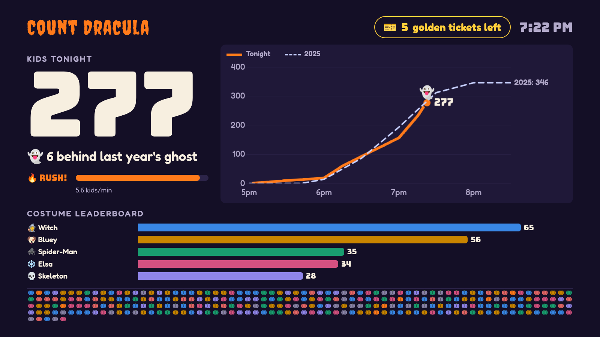

# 🧛 Count Dracula

A Halloween trick-or-treater counter for one household. Helpers at the door tap each kid in on their
phones. A TV facing the porch celebrates every kid live and races tonight's count against last year's.



<p>
  
  
  
</p>

## Features

### At the door (phones)

- **One big button.** "+1 Kid", or tap a **costume tile** to count the kid with their costume. Every tap
  flashes "#N" and buzzes.
- **+ New costume** on the spot, with **catch-up**: "how many did we already see?" re-tags the last few
  untagged kids, so a costume trend is never undercounted.
- **🧑 Teen**: counts the next kid but stops them winning a golden ticket. If a teen lands on a golden
  number, the ticket moves to a new random number further up.
- **Undo** and **Recent**: the last 10 kids from every phone, newest first, each with a ✕ to remove it.
- **Golden banner**: "⭐ NEXT KID IS GOLDEN — get the prize ready", and a strong buzz on the phone whose
  tap actually won.
- **Works offline.** Taps queue on the phone and send when the connection is back. Retries never
  double-count. After about 5 s an amber "⏳ N waiting to send" pill appears. If the server is down for
  more than 2 minutes, it adds "keep tapping, don't reload".
- **☰ Door menu**: TV volume and mutes (ambience, kid bloops, everything), release the remaining golden
  tickets (from 7:45pm), 🌙 End / Resume the night, and **Add a helper**: a QR code that joins a new phone
  without typing anything.
- **Soundboard**: swipe left (or use the 🔊 tab) for six buttons that play on the TV, with a 3 s cooldown
  shared across all phones.

### On the TV

- **The giant count**, which pops and throws confetti from the number for every kid. Several kids arriving
  together merge into one bigger pop.
- **The ghost race**: tonight's line against last year's dashed ghost line, with "👻 4 ahead of last year's
  ghost" under the count. The chart extends in place as kids arrive.
- **Rush meter**: kids per minute over the last 5 minutes, from quiet to 🔥 RUSH!
- **Costume leaderboard**: the top 5 costumes as bars that reorder when one overtakes another.
- **Pumpkin patch**: one pumpkin per kid, coloured by costume. Golden-ticket winners get a gold pumpkin.
- **Milestones**: a headstone rises for every 50th kid. #100, #200 and #300 get a full-screen takeover
  with a giant headstone.
- **Golden tickets**: secret numbers drawn at Go live, spread across the expected night. Nobody sees them,
  the family included. The winner gets a gold full-screen takeover.
- **Beat last year**: a takeover the moment tonight passes last year's total.
- **New costume spotted!**: a banner when a helper adds a new costume.
- **Idle teaser**: after 45 s with no kids, a quiet rotating line ("3 golden tickets still hidden — could be
  YOU!", "Next milestone: kid #150!").
- **Sound**: a bloop per kid that rises in pitch through a merged pop, stings for milestones, a fanfare
  for takeovers, quiet ambience all night. Every sound is CC0 or homemade
  ([public/sounds](public/sounds/README.md)).
- **Calm when the connection drops**: no error screens. A small "🦇 catching up…" chip appears, then the
  count rolls up quietly once it reconnects.
- **End-of-night recap**: the final count and verdict, the finished race, peak half-hour, biggest crew,
  costume of the night, and every golden number revealed. `/tv?event=<id>` shows any past night's recap.

| | |
|---|---|
|  |  |
|  |  |

### Setup (`/setup`, for a household's signed-in Managers)

- **Events**: create a night (copying last year's costumes), **Go live**, change the join key, view, export
  or delete past nights.
- **Per-night settings**: which past night to race against (or an expected number of kids), the number of
  golden tickets (default 5), a clock shift for daytime rehearsals, and the visit window. Add a golden
  ticket after Go live.
- **Costumes**: name, emoji and order (which sets the TV colour).
- **Night tools**: a printable **tally sheet** for when every phone is dead, and **➕ Add missed kids**
  to type the tallies back in afterwards. Each batch can be removed as a whole.
- **⬇ Export** a night as CSV: one row per kid plus half-hour counts, in the same shape next year's
  ghost reads.


<p>
  
</p>

## Running it

Needs [Bun](https://bun.sh). There are no npm dependencies: the browser libraries (Chart.js, Motion,
canvas-confetti, qrcode-generator, the fonts) are vendored in `public/vendor/`, so nothing loads from a
CDN on the night.

```bash
cp config/config.example.json config/config.json
bun start                                          # prints the TV and phone URLs
bun test
```

- **Phone**: `http://<host>:3131/door?key=<join key>` (the server prints it). Phones on a host listed in
  `autoJoinHosts` join automatically.
- **TV**: `http://<host>:3131/tv`. Click **Start the night** once to turn the sound on. `/tv?border`
  checks for overscan.
- **Setup**: `http://<host>:3131/setup`.

`config/config.json` holds the port, the database path, the six soundboard slots and a switch for each fun feature (milestones,
golden tickets, leaderboard, new-costume alert, soundboard, pumpkin patch, recap, rush meter).

### Deploying

The server runs in a Proxmox LXC under systemd, reached on the LAN at `http://192.168.5.31:3131` and on the
tailnet through Caddy over HTTPS. The tailnet hostname stays out of the repo: put
`TAILNET_HOST=count-dracula.example.com` (your own name) in `deploy/local.env`, which git ignores.

```bash
deploy/create-lxc.sh       # once: creates the LXC
deploy/deploy.sh           # runs the tests, ships the checkout, restarts, checks it answers
deploy/deploy.sh --rollback
```

The database and `/etc/count-dracula/config.json` on the LXC are never overwritten. See
[deploy/README.md](deploy/README.md).

### The TV laptop

[kiosk/README.md](kiosk/README.md) covers keeping the laptop awake, a one-command Chrome kiosk launcher
for CachyOS or Windows (which also keeps sound on after a reload), overscan and HDMI sound.

## How it fits together

```
door phones ──POST taps (+ join key)──▶ Bun server ──SSE: snapshot, then numbered deltas──▶ TV + phones
(offline outbox in localStorage)        bun:sqlite (WAL)
```

- `server/`: the HTTP app, the **Ledger** (every write goes through `apply()`, every read through
  `snapshot()`) and the SSE hub.
- `shared/night-maths.js`: pace, the ghost curve, the leaderboard, rush, recap stats. Shared by the server,
  the TV and the tests.
- `public/`: the door phone (`door.html` on `/door`), the TV (`tv.html`), Setup and the tally sheet. Plain ES modules, no
  build step.

The full spec, with the reasoning behind each decision, is in
[.scratch/count-dracula/spec.md](.scratch/count-dracula/spec.md).
